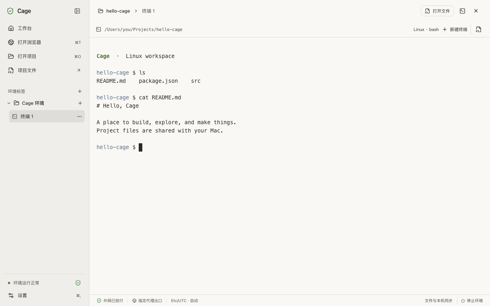

# Claude Cage

**在 Mac 上，为 Claude Code 准备一个独立工作区。**

Cage 把 Linux 终端、浏览器和文件编辑器放进同一个 Mac 应用。开发工具和登录状态留在持久的 Linux 环境中，项目文件与 Mac 共享，外部连接统一经过你选择的代理。

[下载 macOS 版本](https://github.com/Lee-xeo/Claude-Cage/releases) · [开始使用](docs/getting-started.md) · [常见问题](docs/troubleshooting.md) · [参与开发](CONTRIBUTING.md)

## 你可以用它做什么

- **在一个窗口里完成工作。** 用终端运行 Claude Code，用编辑器查看改动，用 Cage 浏览器预览服务和完成登录。
- **控制共享范围。** 只共享默认工作区和明确打开的项目文件夹；主机的 Claude 登录、浏览器配置和 SSH 密钥不会自动导入。
- **看清网络状态。** 内置代理管理支持导入订阅、选择节点和检查出口。关键检查未通过时，环境保持离线；代理不可用时没有直连回退。
- **下次继续使用。** 工具、文件和登录状态保存在虚拟磁盘里，关闭窗口可以保留后台任务。

## 下载与安装

首版面向 **Apple Silicon Mac（M 系列芯片），macOS 14 或更新版本**。Intel Mac、Windows 和 Linux 尚不作为 Cage 桌面版的受支持平台。

1. 打开 [GitHub Releases](https://github.com/Lee-xeo/Claude-Cage/releases)，选择发布条目中的 Apple Silicon `.dmg` 安装包。
2. 打开安装包，将 **Cage** 拖入 **Applications（应用程序）**，再从“应用程序”启动。
3. 按应用内引导配置自己的代理，启动环境后打开项目。

安装包随附工作台和代理核心，日常使用无需安装 Go、Node.js、Docker 或 Clash。首次启动仍需联网下载 Linux 镜像与开发工具；Cage 不提供代理服务或 Claude 账户。

当前处于 Alpha 阶段，仓库与发行物暂仅对获授权的测试者开放。发行物是否已签名、公证及对应验证范围，以具体 Release 说明为准；没有安装包的发布条目不代表已可安装。干净机器安装、真实 Claude 授权与模型请求仍需完整验收。

## 三步开始

### 1. 选择代理

点击首页“配置网络与代理”，再点击“添加来源”，导入 Clash/Mihomo YAML 订阅或本地 YAML 文件，在“节点”中选择一个节点。没有可用代理时，可以明确勾选“通过主机网络下载这份订阅”，或直接导入本地文件。后续可从“设置 → 网络与代理”管理节点。

### 2. 启动环境

返回工作台，点击“启动 Cage 环境”。如果本机 Git 需要安全保护，应用先说明影响，由你点击“启用保护并继续”后设置；普通项目的提交与拉取不受影响。随后下载镜像、安装工具并执行网络检查，可以在“操作详情”查看进度。看到环境就绪、关键检查通过后，即可联网工作；失败时按页面提示修复并重试。

### 3. 打开项目，运行 Claude

点击“打开项目”选择 Mac 上的文件夹，再新建终端，输入 `claude`，在 Cage 浏览器中完成自己的账户授权。也可以先使用默认工作区，无需提前准备项目。完整步骤见[开始使用](docs/getting-started.md)。

## 使用前了解这些边界

- 共享项目中的修改和删除会直接影响 Mac 上的文件。请使用版本控制或备份；`.git` 等元数据默认只读，Git 提交在 Mac 上完成。
- 所有项目共用一个 Cage 环境，也共用其中的工具、账户与 Linux 文件系统。项目之间没有独立隔离。
- 当前允许客机通过代理访问公网 IPv4 TCP，DNS 通过同一代理发送；公网 UDP、IPv6、ICMP，以及客机主动访问主机和局域网的连接受到阻断。依赖这些能力的工具可能无法使用。
- 网络检查展示当前配置和采样证据，无法保证账户不会受到平台限制，也不能代替完整的虚拟化安全审计。

详细机制见[网络与数据边界](docs/getting-started.md#网络与数据边界)、[网络检查设计](docs/design/network-checks.md)和[内置代理设计](docs/design/managed-proxy.md)。

## 文档与贡献

| 你要做什么 | 从这里开始 |
|---|---|
| 第一次安装、配置代理、打开项目 | [开始使用](docs/getting-started.md) |
| 处理下载、启动、联网和登录问题 | [常见问题与恢复](docs/troubleshooting.md) |
| 了解按键、外观、数据保存和退出行为 | [日常使用](docs/getting-started.md#日常使用) |
| 从源码构建或提交改进 | [贡献指南](CONTRIBUTING.md) |
| 了解模块与网络约束 | [工作台设计](docs/design/workbench.md) |
| 报告可复现问题 | [GitHub Issues](https://github.com/Lee-xeo/Claude-Cage/issues) |

## 来源与许可

Cage 基于 [agent-vm](https://github.com/sylvinus/agent-vm) 二次开发，上游基线为 `652688aae92c35ce536b9be52262e1cc5ec6e03a`。感谢 Lima、gvisor-tap-vsock、sshocker、noVNC、Mihomo 等项目提供基础能力。

项目主许可为 [MIT](LICENSE)。随附组件保留各自许可，Mihomo 作为独立可执行文件按 GPL-3.0 分发；请同时参阅 [NOTICE](NOTICE)、[第三方许可](THIRD_PARTY_LICENSES)、[第三方来源](third_party/SOURCES)及 [noVNC 来源说明](ui/vendor/novnc/README.cage.md)。上游项目的说明保存在[上游 README](docs/agent-vm-upstream.md)。

Cage 是独立社区项目，与 Anthropic 无隶属关系。
